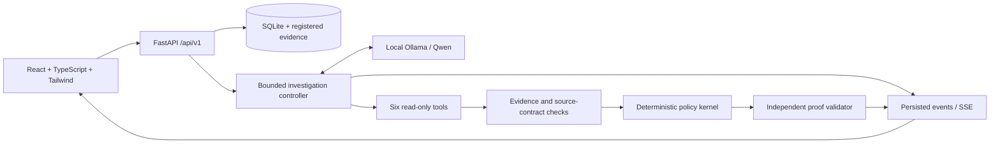
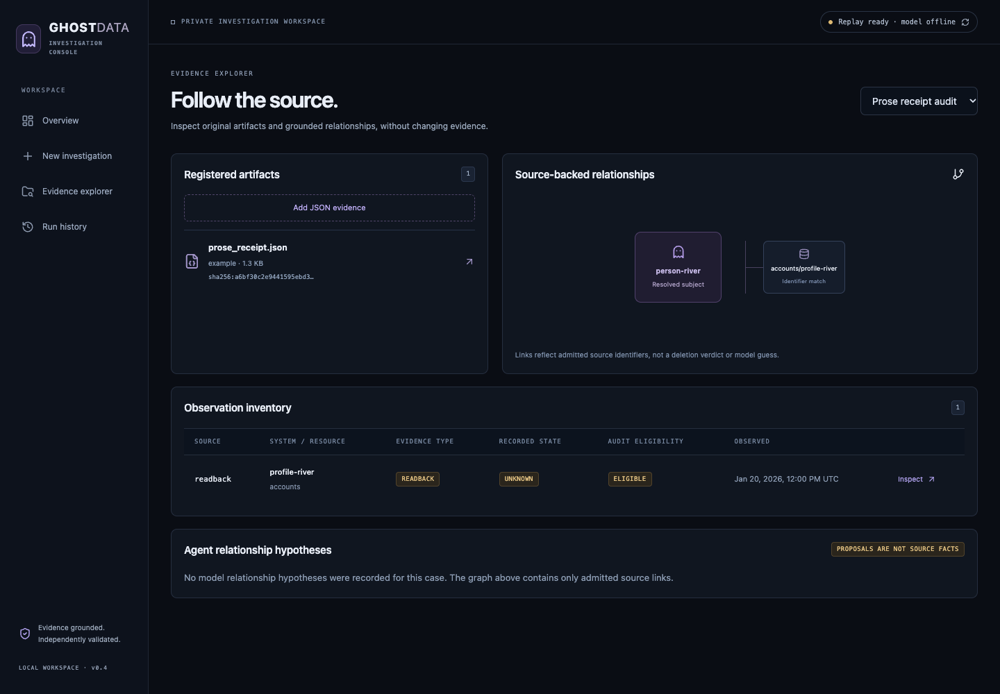
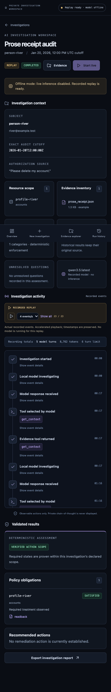

# Ghost Data

**A local, full-stack AI investigation console for evidence-backed data deletion audits.**

A workflow can say “deleted” while a replica, export or restore path still holds the
person's data. Ghost Data investigates the evidence, applies policy, and separates
what is proven from what remains unknown.


*An accelerated walkthrough of actual recorded local-model events and synthetic
evidence. REPLAY is not live inference. No API key or downloaded model is needed.*

## Explore it locally

Requirements: **Python 3.11+**, **Node 22+**, npm, and an internet connection for the
initial dependency install. The release quickstart is tested in a fresh environment;
platform details and exact results are in [release readiness](docs/release-readiness.md).

```sh
git clone https://github.com/amita7898/ghost-data.git
cd ghost-data
python3 -m venv .venv
source .venv/bin/activate
python -m pip install -r requirements-web-tested.txt
python -m pip install --no-build-isolation -e '.[web,dev]'
npm ci --prefix frontend
npm run build --prefix frontend
python scripts/check_setup.py --offline
python scripts/start.py --offline
```

Open **http://127.0.0.1:8000**. Choose **Prose receipt audit**, inspect the accepted
hypothesis and its source, then try **Conflicting readbacks** to see rejected
proposals and an inconclusive result. Playback can be paused, accelerated or shown
in full. Windows activation: `.venv\Scripts\activate`.

**No Ollama calls occur in offline mode.** The app uses genuine bundled recordings,
not fabricated activity. [Demo guide and capture procedure](docs/demo.md) ·
[Troubleshooting](docs/setup.md)

## What is implemented

- **Three-panel investigation workspace:** scope and evidence, observable agent
  activity, independently validated results. No private chain-of-thought display.
- **Genuine local agent:** dynamically chooses six typed read-only tools, inspects
  sources, proposes hypotheses and receives acceptance or rejection feedback.
- **Deterministic safeguards:** request authorization, historical identity links,
  evidence availability, policy treatment, scope and independent proof checks.
- **Evidence inspection:** original JSON, SHA-256 provenance and exact row locators;
  eligible observations remain distinct from excluded or unresolved evidence.
- **Persistent execution:** SQLite history, SSE reconnection, idempotent starts,
  serialized live runs, cancellation, interrupted/failed states and report export.
- **Responsive React UI:** dashboard, investigation creation, evidence explorer and
  run history. JSON uploads are validated and limited to 5 MB.

## How the investigation works



The model selects tools and arguments from the evidence it sees. It can investigate
missing facts, revise a rejected hypothesis or stop within its budgets. A model
summary never sets the audit conclusion. Proposed facts need registered citations
and a supported source contract before the kernel and independent validator admit
them. Claims, partial snapshots and missing data cannot prove deletion.

The interpretation bridge currently supports a narrow, reviewed readback-note
grammar—not arbitrary document understanding. `VERIFIED_WITHIN_SCOPE` means the
required state is supported within the declared inventory, not universal deletion.
[Architecture and trust boundaries](docs/web-architecture.md) · [Agent details](docs/local-agent.md)

## Optional live inference

Install Ollama separately and explicitly choose/download a suitable local model.
The application never downloads weights or falls back to a cloud provider.

```sh
# Separate terminal, once Ollama and qwen3.5:latest are installed:
sh scripts/serve-local.sh
# In the activated project environment:
ghost-data doctor
python scripts/start.py                  # omit --offline
```

Create an investigation from a synthetic example or JSON bundle and select **Start
live**. Reloading preserves progress. Cancellation waits for the bounded in-flight
call. The measured setup is an Apple M3 with 16 GiB unified memory, Qwen3.5 9.7B
Q4_K_M (about 6.6 GB cached assets), Ollama 0.40.13 and a 16,384-token context.
A measured web run took **162.4 seconds**, five model calls/five tool calls and
8,573 reported tokens. Other hardware and mutable model tags can differ.
[Model setup and measured limitations](docs/setup.md#live-local-inference)

## Measured results, including failures

| Evaluation | Result | What it establishes |
|---|---|---|
| Structured synthetic suites: 32 / 128 / 512 cases | 100% conclusion accuracy; zero unsupported verified after hardening | Controlled JSON/temporal/policy regressions, not real-world accuracy |
| Four readback-note diagnostics: deterministic / extraction / agent | 25% / 75% / 75% | Small, narrow-source comparison; no general agent superiority |
| Median runtime on those four cases | 0.0003 s / 25.9 s / 148.7 s | Agent investigation is substantially slower |

The agent proved one absence that extraction missed, but abstained on an injection
case where extraction found the supported violation. A conventional parser could
also implement this receipt grammar. Templates overlap across synthetic suite sizes;
there is no external production validation or certification.
[Methodology and raw results](docs/performance.md)

## Tests and development

```sh
pytest -q                               # local-model test skipped by default
npm test --prefix frontend
npm run build --prefix frontend
# With the offline server running; installed Chrome locally:
npm run test:e2e --prefix frontend
```

CI runs Python, frontend, production-build and offline-browser checks without
Ollama. [View the actual GitHub Actions runs](https://github.com/amita7898/ghost-data/actions/workflows/tests.yml). Live
inference tests are opt-in. [Commands, API types and contribution guide](CONTRIBUTING.md)

<details>
<summary>More application screenshots</summary>





</details>

## Boundaries and next steps

Localhost only; no multi-user authentication or public deployment support. Tools
cannot delete data or authorize destructive actions. JSON-only ingestion; no PDF,
OCR or live database connector. Source authenticity and inventory completeness
remain explicit assumptions. Model output can be wrong; limited prompt-injection
tests do not establish immunity. Review [SECURITY.md](SECURITY.md) before use.

Future work: held-out evidence contracts and latency profiling first, then reviewed
read-only connectors and investigation UX. Broader ingestion and hosted/multi-user
operation need separate safety work. [Roadmap and GitHub metadata](docs/release-plan.md)

Licensed under [MIT](LICENSE). Copyright (c) 2026 Amita Shree S.
Competition assets, private chats, model weights and local investigation databases
are excluded. Dependencies retain their upstream licenses. See
[provenance and licensing review](docs/provenance-and-licensing.md).
