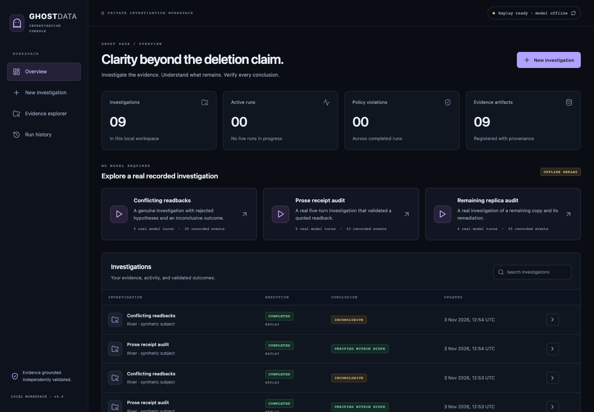
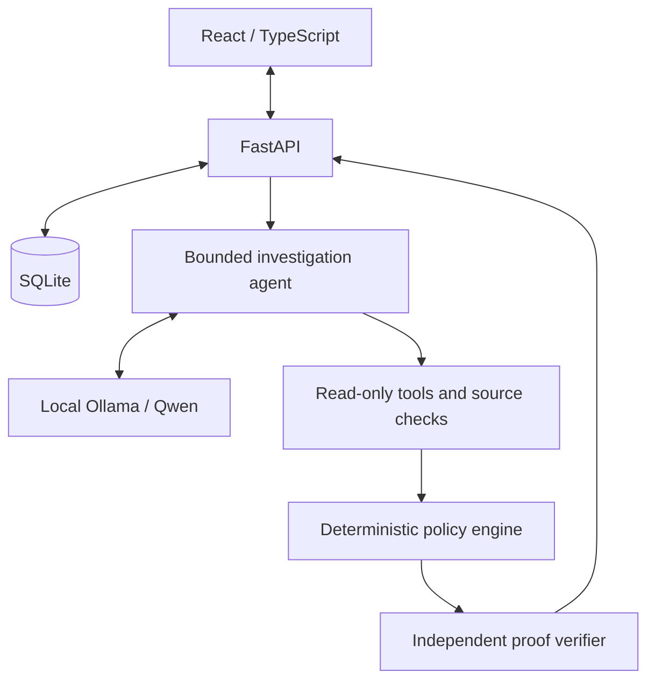

# Ghost Data

**A local workspace for checking data deletion claims against evidence.**

A company says your personal data has been deleted. How can you check that claim?
Copies can remain in replicas, exports or backups, even after a workflow reports
success. Ghost Data examines the evidence behind those claims: a local AI agent
investigates supplied records, while deterministic policy evaluation and an
independent verifier establish what those records support.

Ghost Data audits evidence you provide. It does not delete data or access an
organization’s infrastructure. The
[GDPR right to erasure](https://commission.europa.eu/law/law-topic/data-protection/information-individuals_en)
under Article 17 has conditions and exceptions. Ghost Data provides no legal certification.



*Accelerated replay of saved Qwen tool calls on fictional evidence. Replay requires
no model and does not represent live inference speed.*

[Try offline replay](#option-a-offline-replay) · [How it works](#how-an-investigation-works) · [Architecture](#architecture)

## How an investigation works

1. **Supply a JSON bundle:** the request, identity history, policies, resource
   inventory and evidence observations.
2. **Establish the boundaries:** deterministic checks resolve authorization,
   identity and evidence availability, then assess the declared inventory.
3. **Investigate:** the local model selects scoped, read-only tools to search,
   read sources and inspect resource histories.
4. **Propose:** the model submits cited hypotheses. Source-contract checks admit
   supported interpretations and reject unsupported ones.
5. **Apply policy:** deterministic logic evaluates required deletion, retention,
   redaction, anonymization and recreation-risk treatments.
6. **Verify independently:** a separately implemented checker tests the evidence
   and conclusion. Failed proof withholds the report and preserves the trace.
7. **Review:** the workspace shows the assessment, source references, unresolved
   questions, proposed actions and persistent investigation history.

The LLM proposes interpretations; it cannot authorize deletion or set the final
assessment. Structured facts are audited before model investigation and reassessed
when a supported interpretation is admitted. Tools cannot execute remediation.

## What the conclusions mean

| Conclusion | Meaning | Illustrative example |
|---|---|---|
| `VERIFIED_WITHIN_SCOPE` | Every required state is supported within an inventory declared complete. | Scoped deletion targets are absent and policy-required retained records remain available. |
| `NON_COMPLIANT` | Eligible evidence establishes a policy violation. | A failover profile remains present despite a DELETE requirement. |
| `INCONCLUSIVE` | Proof, authorization, identity or scope is insufficient or conflicting. | A partial snapshot omits a profile but cannot prove its absence. |
| `NOT_APPLICABLE` | The request declines deletion or asks for a different action. | “Export my data” creates no deletion audit plan. |

These assessments cover supplied evidence and scope, not universal compliance.
Execution states such as cancelled, timed out or `verification_failed` are reported
separately from audit conclusions.

## Architecture



| Component | Role |
|---|---|
| React / TypeScript | Investigation workspace, source inspection and activity timeline. |
| Python / FastAPI | Validated API, execution control and streamed events. |
| SQLite | Local evidence registration, run history and persisted events. |
| Ollama / Qwen | Local model inference without cloud fallback. |
| Tool-calling agent | Chooses among six bounded read-only tools and revises hypotheses. |
| Policy engine | Evaluates required treatments using eligible evidence. |
| Independent verifier | Rechecks proof and citations without trusting policy assessments. |

[Architecture and trust boundaries](docs/architecture.md)

## Follow one investigation

The bundled **Prose receipt audit** recording uses
[this fictional input](examples/prose_receipt.json):

- **Request:** “Please delete my account.”
- **Identity:** `river@example.test` maps to the fictional subject `person-river`.
- **Policy:** delete the scoped profile.
- **Evidence:** an exact-resource readback note says:
  `Resource profile-river in accounts belongs to person-river. Observed state: ABSENT.`
  Its structured state is `UNKNOWN`, pending interpretation.

In that recording, the agent reads the receipt and proposes its quoted state.
The source-contract check validates the quotation and identifiers; the kernel and
independent verifier check attribution, cutoff, coverage and policy. The report
contains this conclusion:

```json
{"conclusion": "VERIFIED_WITHIN_SCOPE"}
```

Without the supported interpretation, the structured audit is `INCONCLUSIVE`.
This demonstrates a narrow receipt contract, not general document understanding.
Open **Prose receipt audit** in offline mode to inspect the saved calls and sources.

## Try it locally

### Option A: Offline replay

**Prerequisites:** Python 3.11+, Node 22.12+ and npm. Initial dependency installation
needs internet. No Ollama installation, model weights or API key is required.
Python 3.12–3.14 have been tested; native Windows execution has not. Use `python3`
if that is your system’s Python command.

```sh
git clone https://github.com/Amita7898/ghost-data.git
cd ghost-data
python -m venv .venv
```

Activate the environment with `source .venv/bin/activate` on macOS/Linux, or
`.\.venv\Scripts\Activate.ps1` in Windows PowerShell. Then:

```sh
python -m pip install -r requirements-web-tested.txt
python -m pip install --no-build-isolation -e ".[web,dev]"
npm ci --prefix frontend
npm run build --prefix frontend
python scripts/check_setup.py --offline
python scripts/start.py --offline
```

Open **http://127.0.0.1:8000**. Choose **Prose receipt audit**, inspect its supporting
source, then try **Conflicting readbacks**. Pause, accelerate or show all recorded
events. This mode never calls Ollama. Stop the server with **Ctrl+C**; local history
remains in the ignored `.localdata/` directory.

### Option B: Live local investigation

Complete installation above, then install **Ollama** and the default local model,
`qwen3.5:latest`, separately. Its tested weights occupy about 6.6 GB. Live inference was measured
on an Apple M3 with 16 GiB memory. Ghost Data never downloads weights automatically.

Stop the offline server. On macOS/Linux, start Ollama in another terminal **only if
it is not already running**:

```sh
sh scripts/serve-local.sh
```

In the activated project environment:

```sh
ghost-data doctor
python scripts/start.py
```

Open the same URL, create an investigation from a supplied JSON bundle or synthetic
example, and select **Start live**. Use **Cancel run** to request cancellation;
a bounded in-flight model call may need time to return. Stop the application with
**Ctrl+C**. If you launched the foreground Ollama server above, stop it with Ctrl+C
in its own terminal when finished.

[Setup, Windows runtime settings and troubleshooting](docs/setup.md) ·
[Demo and media guide](docs/demo.md)

## Evaluation

| Evidence | Measured result and scope |
|---|---|
| Automated regression tests | 427 Python tests passed per version on 3.12/3.13/3.14; the opt-in model test passed separately. Ten frontend tests, five offline browser workflows and one live browser workflow passed. |
| Structured synthetic suites | 32/128/512 cases: 100% conclusion accuracy and zero unsupported verified conclusions. Shared templates do not establish real-world accuracy. |
| Four-case exploratory comparison | Earlier four-case run: 25% deterministic, 75% extraction, 100% agent; agent median 178.6 s versus 28.0 s for extraction. One run on four related cases cannot establish general superiority. |
| Experimental advisory questions | Six targeted local-model scenarios emitted no questions; one timed out. Practical usefulness is unproven, and question premises are not independently verified. |

New live runs can take several minutes. Model summaries are untrusted explanations,
not proof. [Evaluation, failures and reproduction commands](docs/evaluation.md)

## Limits and development

- Supplied JSON evidence only: no PDF/OCR ingestion or direct database/cloud connector.
- Source authenticity and inventory completeness are assumptions; missing evidence
  cannot prove deletion or establish coverage outside the declared inventory.
- Authorization uses a conservative grammar. The model can propose unsupported
  interpretations; acceptance requires the supported source contract and proof checks.
- Localhost and single-user only. No public deployment authentication or destructive
  operations are provided. Live AI investigations require installed model weights.

See [SECURITY.md](SECURITY.md) for boundaries and the three accepted moderate
**development-only** dependency advisories. See [CONTRIBUTING.md](CONTRIBUTING.md)
for tests, lint, builds and API generation, and [CI](https://github.com/Amita7898/ghost-data/actions/workflows/tests.yml)
for published workflow results.

[MIT license](LICENSE) · [Provenance and third-party boundaries](docs/provenance-and-licensing.md)
