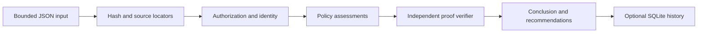

# Ghost Data

An evidence-grounded data deletion investigation platform, under incremental development.

**Implemented: deterministic auditing core, synthetic benchmarks, and a local
LLM investigation agent with recorded offline replay.** The React/FastAPI web
application is the next milestone. The agent uses real Ollama inference and
native tool calls; final audit decisions remain deterministic. No external
resource is deleted or modified.

See [local agent setup, architecture and trust boundaries](docs/local-agent.md).


## Run locally

Python 3.11 or newer:

```sh
python3 -m venv .venv
source .venv/bin/activate
python -m pip install -e '.[dev]'
pytest -q
ghost-data examples/remaining_replica.json --db investigations.sqlite
```

On Windows, activate with `.venv\Scripts\activate`.
For the exact dependencies used in the recorded Milestone 1 run, install
`python -m pip install -r requirements-tested.txt` before the editable install.
The SQLite database stores evidence bytes, reports, and ordered run events; treat
it as private. No server or network listener is started.

## Try the evidence distinction

| Input | Result |
|---|---|
| `examples/remaining_replica.json` | NON_COMPLIANT: a subject-linked copy remains |
| `examples/scoped_absence.json` | VERIFIED_WITHIN_SCOPE: exact-resource readback |
| `examples/claim_only.json` | INCONCLUSIVE: an operation claim is not state proof |
| `examples/partial_snapshot.json` | INCONCLUSIVE: partial coverage cannot prove absence |

These examples were independently authored using fictional identifiers. They are
small core demonstrations, not the synthetic world generator or a benchmark.

## Architecture



The policy engine and proof verifier have separate assessment implementations.
They share typed contracts, identity matching, and authorization utilities; this
is defense in depth, not a mathematically independent formal verification system.
The pure `audit(bundle, digest)` interface will serve the future API and agent.
Only ingestion/CLI code accesses files; the kernel has no filesystem or network tools.

## Input contract

See `examples/` and `src/ghost_data/models.py`. Unknown fields, duplicate IDs,
naive timestamps, invalid intervals and duplicate JSON keys are rejected. The
input is limited to 5 MB. Each observation has its own typed subject identifier,
system/resource namespace, observed/captured timestamps, and claim/readback type.
Reports cite SHA-256 + JSON-pointer locations for observations, identities,
policies, and scope targets. Raw input bytes can be retained in SQLite.

Policies are explicit per-category treatments: DELETE, RETAIN, REDACT, ANONYMIZE,
DISABLE, BLOCK. A missing/false policy condition requires a fallback policy or
review; it never defaults to permission to delete. Redaction requires every
specified field to be observed. Anonymization additionally requires explicit
unlinking verification. Backup blocking requires archive presence. Dependencies
must be resolved; cycles or unresolved prerequisites withhold recommendations.

## Trust boundaries and limitations

- `scope_complete` is a caller-declared bounded inventory, not proof that every
  real system has been discovered. VERIFIED_WITHIN_SCOPE never means universal
  deletion. Scope and source authenticity remain responsibilities of ingestion
  and the investigator; structured fields are not cryptographic attestations.
- A supplied READBACK is an observation assertion from a trusted local adapter.
  The core does not authenticate the originating database or defeat forged input.
- State proof currently requires `observed_at == audit_at`, with capture no later
  than cutoff. Earlier observations remain unresolved; no implicit freshness
  window or assumption of unchanged state is used.
- Authorization supports a conservative subset of wording, with explicit French
  and Spanish refusal regressions. Ambiguous wording requires review. Audit
  permission and permission to execute destructive actions are not granted by
  this classifier; the program only recommends actions.
- Identity matching uses typed exact identifiers, validity intervals and record
  availability. Reassigned historical aliases remain ambiguous. No fuzzy name
  matching or guessed ownership is used.
- Only structured JSON bundles are supported. PDF, OCR, raw SQL/CSV connectors,
  model extraction, live agent tools, API, UI, and replay are future milestones.
- SQLite has no authentication or encryption layer here. Run locally on trusted
  synthetic inputs. It has no public upload surface. Events are application
  history, not tamper-proof logs.
- Frozen models prevent attribute assignment but nested mappings are not deeply
  immutable. Do not mutate models during a run. Persisted source hashes detect
  byte changes; production adapters will need stronger source handling.

## Roadmap

1. Core engine (this version).
2. Synthetic world generator and isolated ground-truth evaluation.
3. Real bounded LLM tool-calling agent, usage accounting, recorded trace replay.
4. FastAPI + React/TypeScript/Vite/Tailwind investigation workspace using real data.
5. Polished offline demonstration, documentation, CI, publication review.

No competition data, private transcripts, or original submission artifacts are
included. Licensing has not yet been selected; do not publish until the owner
approves licensing and the source/history review.

## Synthetic benchmarking

See [benchmark documentation](docs/benchmark.md) and
[Milestone 2 results](docs/milestone-2-results.md). The included representative
suite contains independent fictional data and evaluator-only truth in separate
directories; runtime adapters receive visible bytes only.

```sh
python -m ghost_data_bench.generate /tmp/ghost-suite --seed 42 --size small
python -m ghost_data_bench.run /tmp/ghost-suite --output /tmp/ghost-results --repeats 3
```

Use fresh output paths. These are synthetic diagnostic scores, not production
accuracy. The benchmark exposes known kernel limitations; no LLM improvement is
claimed. See the report before interpreting verification coverage.

Milestone 2.1 hardening: see [evidence admission](docs/evidence-admission.md) and [comparison results](docs/milestone-21-comparison.json). Original benchmark reports remain preserved; corrected runs are under `benchmarks/hardening-*`. All 136 tests pass locally.

## Real local investigation and offline replay

With the official Ollama runtime and the selected model already installed:

```sh
sh scripts/serve-local.sh  # run in another terminal
ghost-data doctor
ghost-data investigate examples/remaining_replica.json --agent local --trace /tmp/live-audit.json --turns 6
ghost-data replay demo/receipt-absent-v4-live.json
```

Replay reads an actual synthetic investigation recording and makes no model
calls. Failed/budget-limited prototype traces are retained with explicit execution
statuses. These recordings do not establish general model reliability. All live
recordings use independently authored fictional evidence. No model weights are
included. Do not upload private evidence traces to GitHub.
