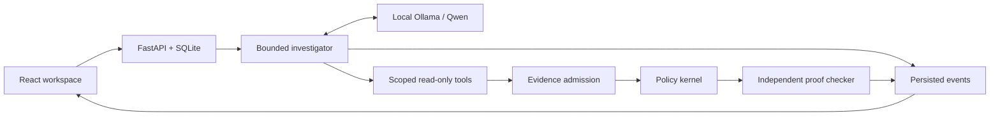

# Ghost Data

**A local AI investigation workspace for evidence-backed data deletion audits.**

“Deleted” in a workflow does not prove that replicas, exports or restore paths are
safe. Ghost Data investigates supplied evidence, applies explicit retention and
deletion policies, and shows what is proven and what still needs checking.

Privacy laws motivate this problem: GDPR Article 17 provides a right to erasure
under specified conditions and exceptions, including certain legal obligations.
See the [European Commission's explanation](https://commission.europa.eu/law/law-topic/data-protection/information-individuals_en).
This project is an engineering demonstration, not legal advice or certification.


*Accelerated playback of saved local Qwen tool calls on fictional evidence. Replay
makes no model calls and does not represent live inference speed.*

## Try the offline demo

Requirements: Python 3.11+, Node 22.12+ and npm. Initial dependency installation
needs internet; playback needs neither Ollama nor API keys.

```sh
git clone https://github.com/amita7898/ghost-data.git
cd ghost-data
python -m venv .venv
# macOS/Linux: source .venv/bin/activate
# Windows PowerShell: .venv\Scripts\Activate.ps1
python -m pip install -r requirements-web-tested.txt
python -m pip install --no-build-isolation -e '.[web,dev]'
npm ci --prefix frontend
npm run build --prefix frontend
python scripts/check_setup.py --offline
python scripts/start.py --offline
```

Use `python3` if your system's Python command is named that way. Open
**http://127.0.0.1:8000**, choose **Prose receipt audit**, inspect its hypothesis and
source, then try **Conflicting readbacks**. Pause, accelerate or show all recorded
events. [Setup and troubleshooting](docs/setup.md) · [Demo/media procedure](docs/demo.md)

## What it does

- A local LLM dynamically chooses six typed read-only tools, retrieves evidence,
  proposes source-grounded interpretations and receives validation feedback.
- A deterministic kernel enforces authorization, historical identity attribution,
  evidence availability, treatment policies and remediation dependencies.
- An independent proof checker validates the result. Failed proof preserves the
  trace and errors in a distinct execution state, with no published audit conclusion.
- React/FastAPI provide an investigation workspace, source inspection, SQLite
  history, streamed activity, cancellation, report export and offline replay.
- Experimental source-linked follow-up questions have host-checked scope/citations.
  Their practical usefulness is not demonstrated; they cannot become audit facts or actions.



The model investigates and proposes; it cannot authorize deletion or set the audit
conclusion. [Architecture, prompts and trust boundaries](docs/architecture.md)

| Audit conclusion | Meaning |
|---|---|
| `VERIFIED_WITHIN_SCOPE` | Every required state is proven within the declared complete inventory |
| `NON_COMPLIANT` | Admitted evidence establishes a policy violation |
| `INCONCLUSIVE` | Evidence, attribution or scope is insufficient or conflicting |
| `NOT_APPLICABLE` | The request declines deletion or concerns a different action |

Execution states such as cancelled, timed out or `verification_failed` describe the
investigation, not a fifth audit conclusion.

## A small example

Run the fully specified fictional [replica bundle](examples/remaining_replica.json):

```sh
ghost-data examples/remaining_replica.json
```

Its request authorizes deletion, its policy requires record removal, and its
subject-linked cutoff readback observes the replica still present. A result excerpt
(JSON, not the full report) is:

```json
{"conclusion":"NON_COMPLIANT","authorization":"AUTHORIZED"}
```

The full result includes the resource, evidence locator and a proposed DELETE
recommendation with `execution_authorized=false`. A deletion claim alone would not
prove absence; missing/partial readback instead leaves that obligation unresolved.

## Optional local LLM

Install Ollama and explicitly choose a tool-capable local model. The application
never downloads weights or falls back to cloud inference.

```sh
# Separate terminal after installing Ollama and the selected model:
sh scripts/serve-local.sh
# Activated project environment:
ghost-data doctor
python scripts/start.py
```

Create an investigation and select **Start live**. See [local model setup](docs/setup.md#live-local-inference)
for Windows environment variables, memory needs, model digest and timeout behavior.
The measured model is Qwen3.5 9.7B Q4_K_M (~6.6 GB assets) on Apple M3/16 GiB.

## Evaluation and development

The structured fixed-seed 32/128/512 regression suites achieve 100% conclusion
accuracy with zero unsupported verified conclusions in the current rerun. They
share templates and do not establish real-world accuracy. The prior remediation’s four-case prose comparison scored 25% deterministic, 75% extraction
and 100% agent, versus 25% / 75% / 75% on the preserved baseline. This is one run
on four related templates, not a reliable generalization claim. The agent median
was 178.6 seconds versus 28.0 for extraction, and it emitted no advisory questions
under the default goals. [Evaluation and methodology](docs/evaluation.md) retain
failures, usage and limitations. No general agent superiority is claimed.

```sh
ruff check src tests scripts
ruff format --check src tests scripts
pytest -q
npm run lint --prefix frontend
npm test --prefix frontend
npm run build --prefix frontend
# Offline server running; local Chrome installed:
npm run test:e2e --prefix frontend
```

[Contribution guide](CONTRIBUTING.md) · [CI](https://github.com/amita7898/ghost-data/actions/workflows/tests.yml)

## Limits and security

Localhost/single-user only; no authentication or public deployment support. JSON-only
ingestion, with a narrow reviewed prose-receipt interpretation contract. No PDF/OCR,
live database connector or destructive operation exists. Source authenticity and
inventory completeness remain assumptions. Authorization is a conservative grammar,
not unrestricted multilingual understanding. Prompt-injection tests do not establish
immunity. See [SECURITY.md](SECURITY.md).

MIT licensed; see [LICENSE](LICENSE) and [provenance](docs/provenance-and-licensing.md).
Original competition assets, credentials, private chats, traces and model weights
are excluded from publication. Runtime investigations stay in ignored local storage.
