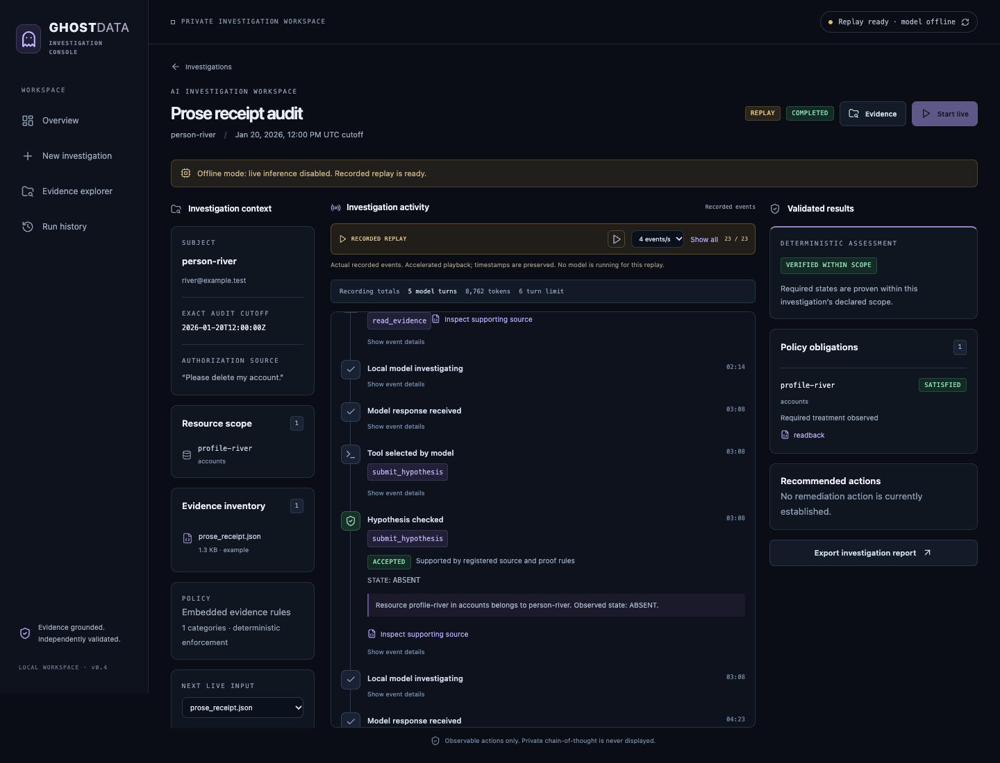

# Ghost Data

A local AI investigation console for data deletion audits. Follow what the agent
actually does, inspect its sources, and distinguish its proposals from independently
validated conclusions.



Ghost Data combines a bounded local LLM agent, read-only evidence tools, a deterministic
policy kernel, independent proof checks, and a React investigation workspace. A
successful deletion message is a claim; it is not automatically proof of absence.

## Try a real recording — no model or API key required

Prerequisites: Python 3.11+ and Node 22+ (Milestone 4 tested with Python 3.14 and Node 25; prior core tests also ran on Python 3.12).

```sh
python3 -m venv .venv
source .venv/bin/activate
python -m pip install -r requirements-web-tested.txt
python -m pip install --no-build-isolation -e '.[web,dev]'
npm ci --prefix frontend
npm run build --prefix frontend
python scripts/start.py --offline
```

Open **http://127.0.0.1:8000** and choose **Prose receipt audit**. It replays a genuine
local-model investigation, including retrieved evidence, a quoted hypothesis,
validation feedback, and its final assessment. Playback is clearly labeled REPLAY.
No model calls occur in offline mode. Windows activation: `.venv\Scripts\activate`.

## Run a live local investigation

Use the existing local Qwen3.5/Ollama setup described in [local-agent.md](docs/local-agent.md).
The project never automatically downloads multi-GB models or falls back to cloud inference.

```sh
# Separate terminal, if Ollama is not already running:
sh scripts/serve-local.sh
# Restart the web application without --offline:
python scripts/start.py
```

In the UI, create an investigation, select a synthetic example or upload a supported
JSON bundle, configure its scope/cutoff, then choose **Start live**. Runs are serialized.
You can reload or leave the page; progress is persisted. Cancellation waits for the
bounded in-flight model call. Completed, failed, cancelled, and interrupted states
are distinct from the audit conclusion.

The existing CLI still works:

```sh
ghost-data doctor
ghost-data examples/remaining_replica.json
ghost-data investigate examples/prose_receipt.json --agent local --trace /tmp/audit.json
ghost-data replay demo/receipt-absent-v4-live.json
```

## Application

- **Overview:** actual investigations, active runs, evidence counts and curated recordings.
- **New investigation:** JSON upload/progress, source validation, human scope and exact cutoff settings.
- **Investigation workspace:** context, genuine model-selected tool activity, hypotheses, validation and final results.
- **Evidence explorer:** safe source previews, exact SHA/row references, source links and separate model hypotheses.
- **History:** saved runs, report downloads, and side-by-side run summaries without claiming accuracy comparisons.

Supported uploads are structured JSON bundles only, up to 5 MB. PDFs, screenshots,
raw SQL/log imports and general document interpretation are not implemented.

## Architecture and API

React + TypeScript + Vite + Tailwind; FastAPI + Pydantic; SQLite; local Ollama.
One modular backend, one inference worker, persisted SSE events; no Redis,
PostgreSQL, distributed queues or multi-agent framework.

See [web architecture and trust boundaries](docs/web-architecture.md). Versioned API:
`/api/v1`; interactive documentation: `/docs`; machine-readable contract: `/openapi.json`.
TypeScript DTOs in `frontend/src/api.generated.ts` are generated from that contract.

```sh
python scripts/export_openapi.py
npm run api:types --prefix frontend
```

For frontend development, start the API and run `npm run dev --prefix frontend`
in another terminal. Vite binds to localhost:5173 and proxies `/api` to localhost:8000.
`python scripts/start.py --data-dir /your/private/directory` selects local storage.

## Tests

```sh
pytest -q
npm test --prefix frontend
# With the offline app running on port 8000:
npm run test:e2e --prefix frontend
# Opt-in actual inference tests, with normal live mode enabled:
GHOST_DATA_REAL_SMOKE=1 pytest -q tests/test_agent.py::test_real_model_emits_tool_call
GHOST_DATA_LIVE_WEB=1 npm run test:e2e --prefix frontend -- e2e/live.spec.ts
```

Local Playwright uses installed Chrome; CI installs Chromium. Keep live tests serialized.
[Milestone 4 results](docs/milestone-4-results.md) records executed checks, genuine live
run measurements and limitations. CI configuration is included; no remote CI run is
claimed. [Milestone 3 results](docs/milestone-3-results.md) documents the small local-model
comparison, including failures and complementary extraction/agent errors.

## Boundaries and limitations

This is a **local-only application**, not a public SaaS deployment. No multi-user
authentication is included. Do not bind it publicly. Model tools cannot execute
deletions, authorize requests, change policy, read arbitrary files or override proof
validation. Metadata/source authenticity and declared inventory scope remain explicit
trust assumptions. VERIFIED_WITHIN_SCOPE does not mean universal deletion.

Inference is slow on the tested M3 (the M3 agent benchmark median was ~149 seconds).
The receipt interpreter is deliberately narrow. Model summaries can be wrong and
are visually separated from validated facts. A larger, held-out evaluation remains
necessary before claiming broad agent superiority or prompt-injection immunity.

Private evidence/history live in `.localdata/`, excluded from Git. Model weights,
private transcripts and original competition assets are not included. Public demos
use independently authored fictional data. No repository has been pushed or published.
Licensing remains an owner decision before release; model/runtime notices are linked
in the local-agent documentation. Preserve and review private evidence before exports.

## Project map

```text
frontend/src/pages/       React pages and responsive workspace
frontend/e2e/             Real-browser workflows
src/ghost_data/web/       HTTP adapters, services, SQLite repository
src/ghost_data/agent/     Local inference, tools, validation, traces
src/ghost_data/           Preserved auditing kernel and CLI
src/ghost_data_bench/     Synthetic worlds and evaluator-only scoring
examples/ · demo/         Synthetic inputs and genuine recordings
docs/                    Architecture, OpenAPI, screenshots, measurements
```
