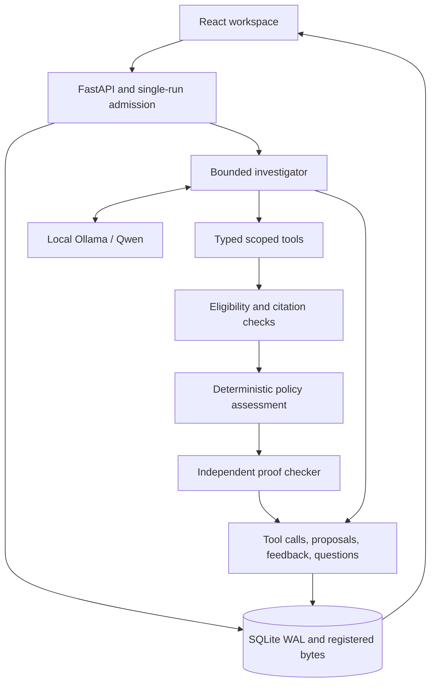

# Architecture and trust boundaries

Ghost Data is a single-user local investigation application. FastAPI runs one
bounded background investigation per private data directory; React consumes durable
SQLite events through cursor-based SSE. The CLI uses the same controller and kernel.
The model has six read-only capabilities, not general filesystem or network access.

## Evidence and policy

A `Bundle` contains the request, identity history, rules, declared resource inventory
and observations. Exact JSON bytes are SHA-256 registered. Locators point to rows in
those bytes; hashes establish consistency, not source truth. Business claims remain
distinct from actual readbacks. Partial absence, missing fields, stale observations
and conflicting states cannot establish deletion. See [admission rules](evidence-admission.md).

Historical identifiers can establish links when their validity and recording times
permit them. A reused request identifier cannot silently select the former owner:
ambiguous subject attribution stops proof. The inventory must be declared complete
before the kernel can conclude `VERIFIED_WITHIN_SCOPE`. This is a scope assumption,
not automatic discovery of every real-world copy.

Policy and verifier deliberately implement state-treatment logic separately. The
verifier reads policy and eligible observations directly; it checks citation
completeness, authorization, ownership, obligations, remediation dependencies and
conclusion consistency. Sharing the eligibility predicate avoids inconsistent
admission, while separate treatment logic catches assessment mistakes. Randomized
contract tests supplement targeted adversarial tests; neither is a formal proof.

## Model contribution

The model dynamically selects `get_context`, `search_evidence`, `read_evidence`,
`resolve_identity`, `inspect_resource` and `submit_hypothesis`. Search indexes actual
values, not JSON schema keys. Each tool has its own handler, typed arguments and a
bounded response. Evidence text is untrusted; it cannot change tools or policy.

The initial deterministic assessment identifies known obligations and gaps. The
model can retrieve prose receipts, propose an exact quotation under the supported
readback-note contract, receive rejection feedback, and revise its investigation.
The contract validator checks identifiers, source type, exact text and state;
accepted interpretations are then reassessed and independently verified. Arbitrary
PDF/log understanding and open-ended relationship inference are not implemented.

Prompt files are packaged under `ghost_data/agent/prompts/`. The original v4 text
is preserved byte-for-byte after removing the file's terminal newline; its digest
matches bundled recordings. v5 adds experimental optional structured follow-up questions for
unresolved resources. Scope and eligible, actually-read citations are checked again.
No-source questions are allowed only when that resource has no eligible evidence.
A linked question remains **unverified advisory model text**; it never changes an
assessment, authorizes an action or proves its own premise. Old completions without
questions remain valid. Traces record prompt version/hash, schema hash, model
metadata, usage, tool feedback and questions; hidden model thinking is not retained.

## Authorization and confirmation

Supported first-person requests are classified by a conservative multilingual
grammar. Refusals and non-deletion requests produce no action plan; conditional,
quoted, conflicting or uncertain instructions remain non-authorizing. Unsupported
languages and constructions can abstain. An LLM summary is never authorization,
and even an authorized audit cannot execute deletion: every recommendation has
`execution_authorized=false`.

A future confirmation flow should show the exact requested scope and retention
exceptions, authenticate the requester, require an explicit new affirmative request,
and preserve its identity, timestamp and original wording as a new registered
artifact. It must not rewrite a historical request or cutoff. Re-run deterministic
authorization and identity checks; the model cannot set a confirmation flag. No
unchecked “authorize” checkbox or confirmation endpoint is introduced in this version.

## Execution, persistence and replay

SQLite WAL stores events before SSE delivery. Idempotency keys and a unique active-run
index prevent duplicate inference; a data-directory lock prevents two API owners.
Cancellation is cooperative and bounded by the in-flight request timeout. Restart
marks orphaned runs interrupted, without pretending to resume model reasoning.
CLI and API connections close explicitly. The gate does not coordinate unrelated
CLI/model clients; serialize those manually.

Execution state is separate from the four audit conclusions. Independent proof
failure yields `verification_failed`, preserves the full journal and validation
errors, and withholds the report/conclusion. A cancellation or shutdown arriving
after failed verification cannot replace that terminal status. This state propagates
through persistence, SSE and the UI. Runtime errors have separate model-service messages. A valid kernel assessment
may be visible after a cancelled/budget-limited investigation with a clear execution
warning; failed proof can never publish one. No database migration is required for
the added execution state because SQLite stores it as text.

Curated replay checks input/recording hashes, event order and final-report consistency.
It makes no model calls. Schema-1 successful recordings remain compatible; proof-failed
traces require null report and matching final validation errors. These checks are not
cryptographic attestation, and arbitrary uploaded traces are not trusted demo sources.

## Boundaries

Loopback Host/Origin checks, escaped text rendering, bounded uploads and registered
source lookups apply to the local application. No authentication, destructive tools,
public deployment hardening or OS-level sandbox is provided. Native Windows behavior
and unrestricted evidence ingestion need further testing. See [SECURITY.md](../SECURITY.md)
and [setup](setup.md).

Advisory questions remain experimental: the targeted six-case local-model probe
produced no questions, including four missing-information opportunities. Five runs
completed and one exhausted its time budget. Host checks verify scope and citations,
not whether a question's wording is useful or its premise is true. Unverified prose
must never become an accepted fact, authorization or compliance conclusion.

The pre-release consent gate anchors supported English request forms and preserves
question punctuation. Explicit negative consent, reported/quoted wording, bare
questions, unsupported future timing and mailing-list opt-outs cannot create a full
deletion audit. Unsupported phrasing can still abstain; this is not a production
consent-understanding service. Identity tools additionally reject non-authorizing
requests and expose ambiguity without returning another subject's identity rows.
