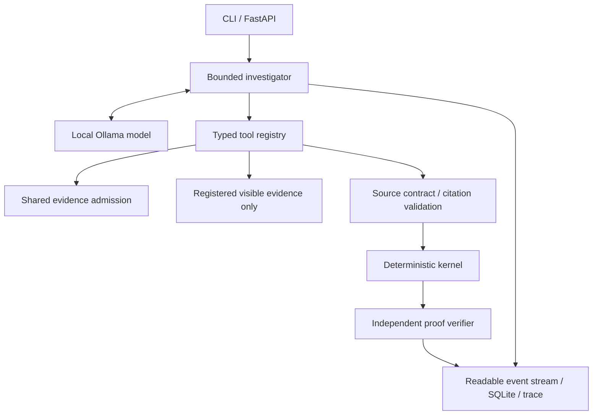

# Local investigation agent — Milestone 3

The agent uses real local Ollama /api/chat tool calls. It has six typed read-only
tools and a bounded controller. The React/FastAPI application now exposes this same controller; see
web-architecture.md for the current UI, durable SSE events and single-run admission.

## Installation and execution

Python 3.11+; existing setup remains valid. No new Python dependencies are needed.

```sh
python3 -m venv .venv
source .venv/bin/activate
python -m pip install -r requirements-tested.txt
python -m pip install --no-build-isolation -e '.[dev]'
sh scripts/serve-local.sh  # separate terminal; localhost; cloud disabled
# On this machine: runtime installed in ~/Applications/Ollama.app
# On another machine install Ollama from its official site first.
ghost-data doctor
ghost-data investigate examples/remaining_replica.json --agent local --trace /tmp/my-investigation.json --db /tmp/my-investigations.sqlite
ghost-data replay demo/remaining-replica-v2-live.json
pytest -q
```

The project never silently downloads a model. On a new machine, inspect the
model's current download size before explicitly running `ollama pull qwen3.5`.
This machine reused 6,594,474,711 bytes of cached model assets (9.7B Q4_K_M).
The installed Ollama 0.40.13 archive was 229,773,910 bytes; app disk use was
711,564 KiB. The app was signature-verified. No weights/runtime binaries are
included in this repository. The cached model license is Apache-2.0; review the
upstream license and notices before any redistribution. The application is MIT licensed; dependencies/model/runtime retain their own terms.

Chosen model: qwen3.5:latest, actual digest recorded in traces. The mutable tag is
not a reproducibility guarantee; doctor exposes the actual digest for comparison.
The other cached model, gemma3:4b, advertises completion/vision but not tools.
The existing Qwen model avoids another multi-GB download and supports Metal on
the M3. This is a practical, measured selection, not a claim of universal model
superiority. MLX would require a different weight/runtime setup; llama.cpp alone
would need additional model-template/tool-parser integration. Smaller models may
improve speed but were not downloaded or compared. Larger models are a poor fit
for the current 16 GiB machine without additional memory-pressure measurements.

## Architecture and trust boundaries



get_context, search_evidence, read_evidence, resolve_identity, inspect_resource,
and submit_hypothesis are defined in agent/tools.py. No tool grants shell, SQL,
network, filesystem or destructive access. Tool arguments use Pydantic schemas;
results are capped at 6,000 JSON characters, lists are paginated/bounded, and
unknown resources, citations and identifiers are rejected. Admission applies the
Milestone 2.1 chronology, ownership, cutoff and availability rules.

The model chooses tools and arguments from its results. It can finish early,
revise proposals rejected by the host, or hit an explicit execution limit. The
last budgeted model turn is constrained to a completion schema with no tools.
The model's summary is a proposal, never the final audit status. The original
kernel remains the final authority; cancelled/failed/budget-limited execution is
reported separately from the deterministic assessment already available.

A real first run exhausted its budget after nine selected tool calls. It remains
preserved as a failed live trace; it is not counted as a successful investigation.
No tool itinerary or agent response is scripted in live runs. Unit tests use
explicit test_runtime labels; replay rejects those labels.

## Narrow interpretation bridge

agent/interpretation.py supports one reviewed source contract for registered
READBACK observations with UNKNOWN state, source_kind=resource_readback_note and
an exact receipt sentence. The model locates/proposes the sentence; deterministic
parsing verifies the literal subject, system, resource and state, rejects
contradictory sentences, and requires exact coverage for absence. CLAIM records
cannot be promoted. Accepted derived observations preserve the original source
locator and note; kernel and independent verifier check their resulting proof.
This is a constrained extraction capability, not unrestricted semantic truth
verification. Adding free-form prose facts without a new reviewed source contract
would be unsafe. A conventional parser could support this receipt grammar too;
benchmark gains demonstrate source interpretation/orchestration, not unique LLM
reasoning or broad superiority over possible deterministic baselines.

## Limits, errors and observability

Limits cover turns, calls, context, cumulative tokens and wall time. Context uses
a conservative UTF-8 byte estimate; it can stop before the model's actual token
window is full. Successful responses supply Ollama token and duration counters;
failed calls cannot supply reliable token counts. Request timeouts cap waiting
but do not guarantee the server immediately stops computing. Runtime errors stop
the run explicitly; there is no cloud fallback. Invalid final JSON receives
feedback for a later turn. Invalid tool arguments produce safe errors.
Cancellation is cooperative between calls; the in-flight call remains bounded
by its timeout. Keyboard interruption records cancellation in the controller.
A process kill can still prevent the final trace write. This version writes the
complete trace at run end; on_event callbacks can stream events to a future UI.
The CLI still writes its final trace at run end. The web adapter now persists per-event progress and marks interrupted runs after restart; it does not resume inference.

Events distinguish model requests/responses, typed tool calls, source results,
proposal acceptance/rejection, model summaries, errors, and deterministic results.
Separate thinking output is never retained. Trace files may include source PII;
keep private traces local and publish only the included synthetic demonstrations.
There is no automatic general PII scrubber, because stripping identifiers can
break evidence provenance. Review traces before export.

Replay displays recorded events without inference or API keys. It checks schema,
ordered event identifiers, report structure and final-report consistency. A
live_local label and a checksum do not cryptographically authenticate a trace;
recordings are auditable project artifacts, not tamper-proof attestations.

## Reproduce comparisons

```sh
python -m ghost_data_bench.local_agent benchmarks/agent-challenge --output /tmp/local-comparison
GHOST_DATA_REAL_SMOKE=1 pytest -q tests/test_agent.py::test_real_model_emits_tool_call
```

Use a fresh output directory. The comparison runs deterministic-only, one-shot
LLM extraction, and dynamic investigation. Labels are opened only after runtime
execution. It is a four-case diagnostic involving a narrow source contract,
not a broad natural-language benchmark. Prototype and final-prompt recordings
must be distinguished; source/prompt changes are documented with results. An
optional challenger was not added: current evidence does not justify its extra
complexity or inference cost. Existing generic benchmark mode placeholders are
retained for compatibility; use local_agent for actual local comparisons.

## Current operating limits

Use one live investigation at a time on this 16 GiB machine. Ollama is configured
for one parallel inference slot. Concurrent clients can wait in its queue and
exhaust their request or investigation deadlines. The web adapter now gates one active live run and one backend per data directory.
Independent CLI clients are outside that gate; callers must serialize those runs. Some
exploratory measurements were made while another diagnostic was running and
must not be treated as isolated latency benchmarks. See web-architecture.md for implemented API admission and restart behavior.

The current controller allows schema-bounded completion retries within the final
two turns. It does not retry failed HTTP model calls automatically, since a timed
out call might still be computing. Start/check the local service with doctor and
rerun with a new trace path after a failure. Execution status must be checked
alongside the deterministic report. Completed means a valid model completion was
received; it does not imply that every obligation was proven or that the model
made any new discovery.

Memory measurements in local-runtime-measurements.json are snapshots, not peaks.
Ollama allocation and process RSS overlap on unified memory; do not add them as
independent RAM requirements. Keep context bounded (16,384 configured here) and
measure pressure with other applications open. The runtime advertises a much
larger model context, which is not used or promised to fit on this machine.
CLI options expose --turns, --tool-calls, --tokens, --output-tokens, --context,
--seconds and --timeout; investigate --help documents them.

Model summaries remain unverified model content; render them separately from
accepted facts and the authoritative deterministic report. Temperature zero and
a fixed seed do not guarantee identical model tool sequences across hardware or
runtime versions. The four-case comparison has one run per mode/case, not a
statistical repeatability study.

Reproduce challenge inputs and rescore an existing run without inference:

```sh
python -m ghost_data_bench.challenges /tmp/receipt-suite
python -m ghost_data_bench.reporting benchmarks/local-agent-final-results --suite benchmarks/agent-challenge
```
