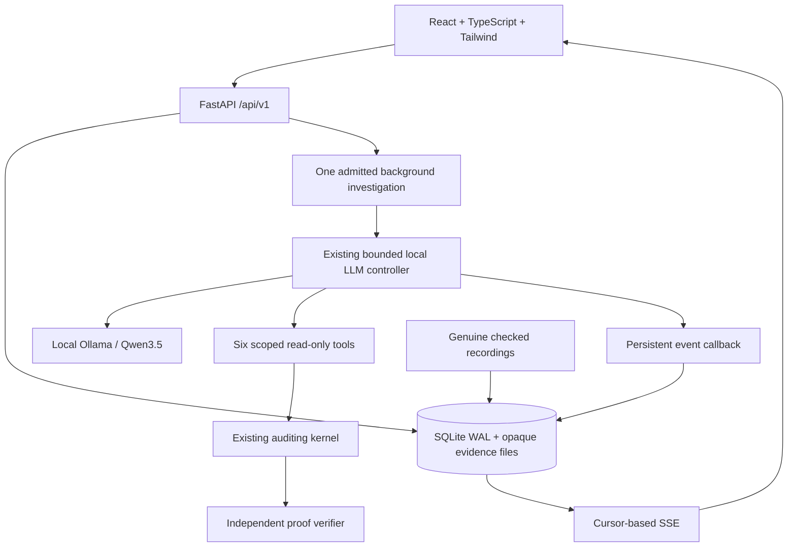

# Local full-stack architecture (Milestone 4)

The core, agent, and existing CLI remain independent of HTTP and presentation.
New API/service/repository modules are under `src/ghost_data/web/`; React pages
are under `frontend/src/pages/`. No distributed queues or services are introduced.

## Lifecycle and concurrency

A unique partial SQLite index admits one queued/running/cancelling live run across
the application. A per-data-directory process lock enforces one backend owner.
POST start requires an idempotency key; retrying the same input/key returns the
same run. Different requests cannot accidentally start simultaneous inference.
A background worker invokes the real existing Investigator. It never generates
scripted tool decisions. Browser closure or reload does not cancel it.

Each callback is committed to SQLite with a monotonic sequence ID. The SSE route
reads persisted events, honors Last-Event-ID and an initial after cursor, sends
heartbeats, and ends after committed terminal state. The React event state is
scoped to its run ID, merges duplicate sequences, and rejects stale case loads.
Cancellation is a persisted request; an in-flight model call can take up to its
configured timeout to return. Cancellation wins a concurrent completion commit.
Status and the final host event commit atomically. Stale workers cannot overwrite
terminal/interrupted results. Restarted active jobs become interrupted, never
silently completed or automatically repeated. Retry creates a separate run.

Execution status and audit conclusion are separate. A failed/cancelled run may
have a deterministic assessment from already processed evidence; the UI clearly
marks the incomplete execution. Model summaries remain unverified model content.
The final report comes only from the existing kernel and independent verifier.

## Evidence and configuration

Initially the only upload format is a Ghost Data structured JSON Bundle, maximum
5 MB. Raw bytes are streamed with a limit, duplicate JSON keys and unknown schema
fields are rejected, and filenames are validated but never used as storage paths.
Files receive opaque UUID keys in a controlled directory. Reads check registered
size and SHA-256 before parsing; symlink/path escapes are rejected. Preview text
is bounded, rendered as text, and links resolve only registered SHA/JSON-pointer
sources. Original bytes can be downloaded explicitly.

Investigation subject labels are presentation only: authoritative identity and
request intent come from the evidence. Policy selection currently means the
embedded rules, with no invented alternative policy presets. Scope and cutoff
are explicit human settings. Unedited source cutoff precision is retained. When
settings change input semantics, a configured copy with its own hash is stored;
the original stays available. The agent cannot alter those settings. Each run
pins its own input artifact; adding evidence never rewrites historical results.
Separate bundles are not automatically merged.

The relationship graph supplements a table. It displays admitted identifier
links, not a global deletion verdict. Model relationship hypotheses appear in a
separate section with their validation disposition. Source authenticity and
inventory completeness remain the same caller/adapter assumptions as in M3.

## Replay

The replay registry contains fixed genuine M3 recordings. Import checks recording
hash, trace/report consistency and input hash before creating an investigation.
It never invokes the runtime. The browser plays actual events at an explicitly
accelerated event rate, preserving recorded timestamps. Replay position survives
reload. No uploaded file can be treated as a trusted recording or final report.

`--offline` disables live startup and model status queries, so the web application
can be reviewed without Ollama or model weights. Prior completed live events can
also be reviewed from local history without restarting inference.

## Local security boundary

Bind to 127.0.0.1. Host and browser-origin checks block remote-origin requests and
DNS-rebinding hostnames; dev origins are limited to the documented Vite ports.
No multi-user authentication is implemented. This local build is NOT suitable
for public exposure without authentication, authorization, network hardening,
quotas, and a deployment/security review. Trusted local processes still have
access; the app is not an OS sandbox or a cryptographic evidence attestation.

No API exposes arbitrary files, shell, SQL, model internals or destructive agent
actions. Runtime status returns only readiness/model label. Private data lives
under `.localdata/` (ignored by Git); the directory is created owner-only. Keep
private evidence and events local. Demo sources and screenshots are synthetic.
Do not publish `.localdata`, browser test traces of private evidence, keys, caches,
competition files or internal development transcripts.

The single-run gate coordinates this API, not an independent CLI/model client.
Avoid simultaneous CLI and web investigations. Tested on this Mac; the lock has
POSIX/Windows implementations, but native Windows has not been tested. SQLite
schema creation is version-local; production migrations and data retention/deletion
UI are future release work. There is no resumable model execution after a crash.
